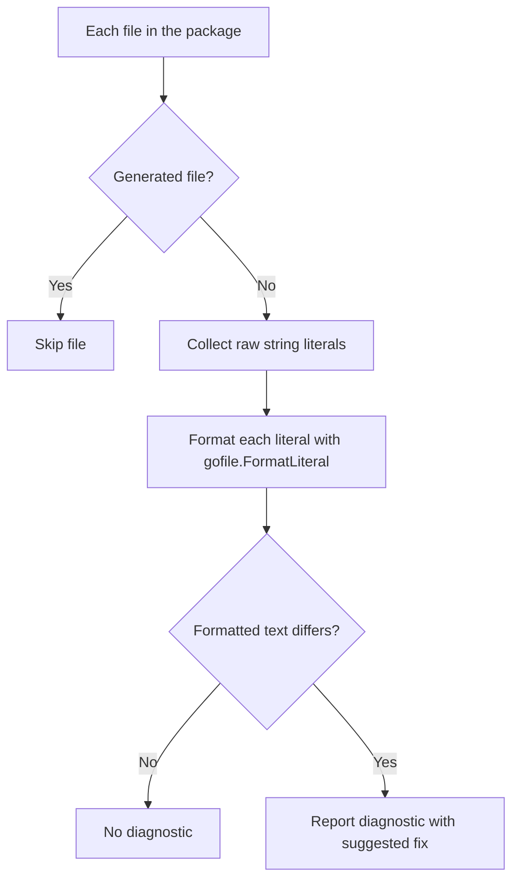

# Analyzer Specification

`internal/analyzer` provides a [`go/analysis`](https://pkg.go.dev/golang.org/x/tools/go/analysis) analyzer that reports embedded SQL raw string literals whose source text would change under sanat's formatter. It is the shared core of the standalone lint command and the golangci-lint integration.

## API

```go
func New(opts gofile.Options) *analysis.Analyzer
```

The analyzer is constructed with fully resolved formatter options. It does not read configuration files or define flags; resolving `.sanat.toml` / `.sanat.yaml`, CLI flags, or golangci-lint settings is the caller's responsibility. Any option added to `gofile.Options` (for example, the SQL dialect) is honored automatically.

## Processing Flow



- **Detection and formatting** reuse `gofile.FormatLiterals`, so the analyzer reports exactly the literals the formatter would rewrite. Strings rejected by `MightBeSQL` (see [detect-spec.md](detect-spec.md)) and SQL the parser cannot handle are never reported.
- **Generated files** (those detected by `ast.IsGenerated`, i.e. containing a `// Code generated ... DO NOT EDIT.` comment) are skipped regardless of the driver, because their literals cannot be fixed by hand (for example, sqlc output).
- Whether `_test.go` files are analyzed is decided by the driver.

## Drivers

- **Standalone lint command** (`sanat lint`, see [formatter-spec.md](formatter-spec.md#lint-command)): loads packages with `golang.org/x/tools/go/packages` and runs the analyzer through `golang.org/x/tools/go/analysis/checker`, so the CLI controls output and exit status. Options are resolved from the formatter's flags and configuration file. Because the analyzer uses no facts, only the requested packages are loaded from source. Suggested fixes are not applied.

## Diagnostics

| Field | Value |
|---|---|
| Analyzer name | `sanat` |
| Granularity | One diagnostic per literal |
| `Pos` / `End` | Start and end of the whole literal, including backticks |
| Message | `SQL literal is not formatted` |
| Suggested fix | A single `TextEdit` replacing the whole literal with the formatted literal |

The suggested fix is always attached. Raw string literals cannot contain backticks, so replacing the whole literal with a new raw string literal is always safe.

The analyzer never modifies source files; applying fixes is left to the driver.
