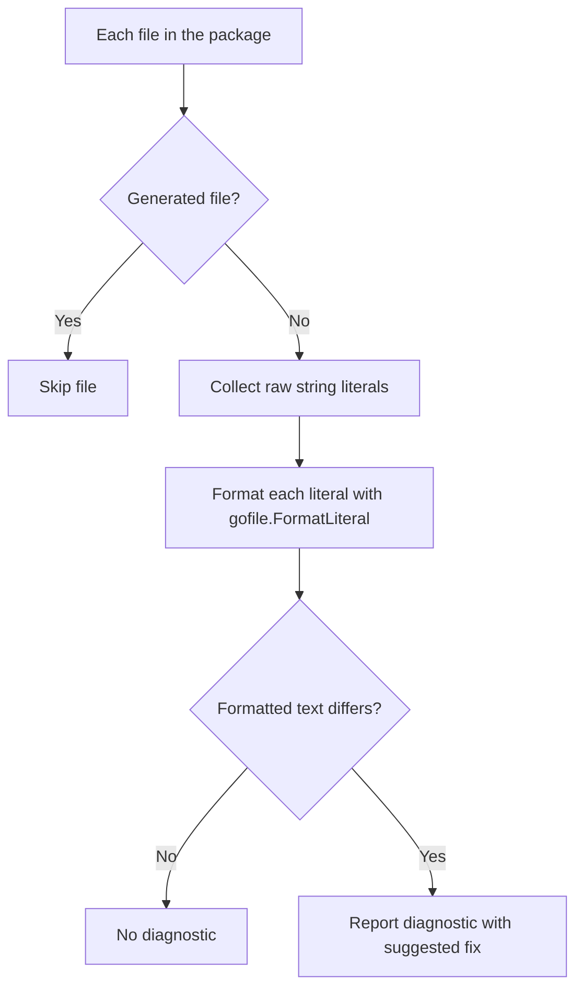
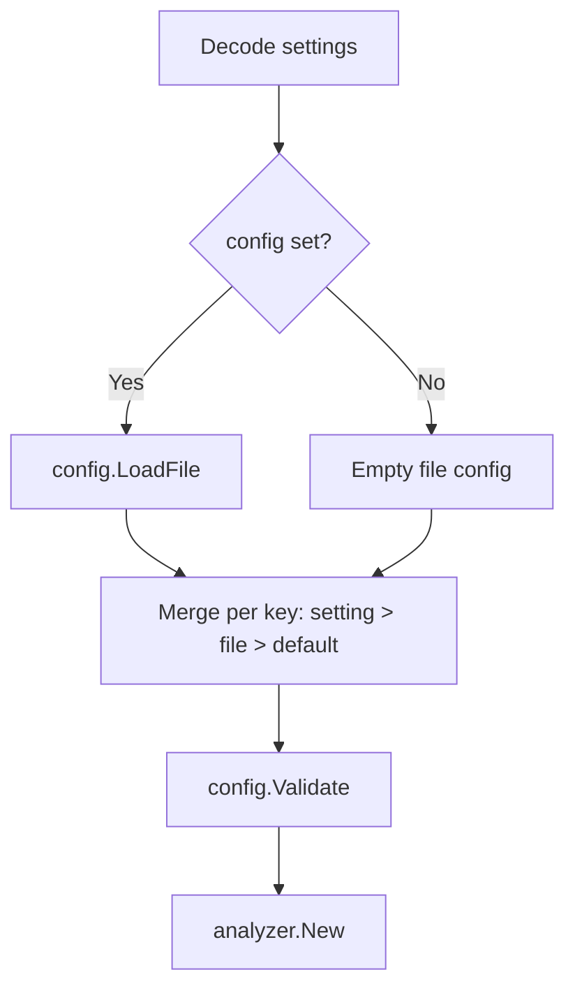

# Analyzer Specification

`internal/analyzer` provides a [`go/analysis`](https://pkg.go.dev/golang.org/x/tools/go/analysis) analyzer that reports embedded SQL raw string literals whose source text would change under sanat's formatter. It is the shared core of the standalone lint command and the golangci-lint integration.

## API

```go
func New(opts gofile.Options) *analysis.Analyzer
```

The analyzer is constructed with fully resolved formatter options. It does not read configuration files or define flags; resolving `.sanat.toml` / `.sanat.yaml`, CLI flags, or golangci-lint settings is the caller's responsibility. Any option added to `gofile.Options` (for example, the SQL dialect) is honored automatically.

## Processing Flow



- **Detection and formatting** reuse `gofile.FormatLiterals`, so the analyzer reports exactly the literals the formatter would rewrite. Strings rejected by `MightBeSQL` (see [detect-spec.md](detect-spec.md)) and SQL the parser cannot handle are never reported.
- **Generated files** (those detected by `ast.IsGenerated`, i.e. containing a `// Code generated ... DO NOT EDIT.` comment) are skipped regardless of the driver, because their literals cannot be fixed by hand (for example, sqlc output).
- Whether `_test.go` files are analyzed is decided by the driver.

## Drivers

- **Standalone lint command** (`sanat lint`, see [formatter-spec.md](formatter-spec.md#lint-command)): loads packages with `golang.org/x/tools/go/packages` and runs the analyzer through `golang.org/x/tools/go/analysis/checker`, so the CLI controls output and exit status. Options are resolved from the formatter's flags and configuration file. Because the analyzer uses no facts, only the requested packages are loaded from source. Suggested fixes are not applied.

## Diagnostics

| Field | Value |
|---|---|
| Analyzer name | `sanat` |
| Granularity | One diagnostic per literal |
| `Pos` / `End` | Start and end of the whole literal, including backticks |
| Message | `SQL literal is not formatted` |
| Suggested fix | A single `TextEdit` replacing the whole literal with the formatted literal |

The suggested fix is always attached. Raw string literals cannot contain backticks, so replacing the whole literal with a new raw string literal is always safe.

The analyzer never modifies source files; applying fixes is left to the driver.

## golangci-lint Integration

The `plugin` package (`github.com/Eagle-Konbu/sanat/plugin`) registers the analyzer with the golangci-lint v2 Module Plugin System under the name `sanat`. It is compiled into a custom binary with `golangci-lint custom`; the stock binary cannot load it.

| Item | Value |
|---|---|
| Registration | `register.Plugin("sanat", plugin.New)` |
| Load mode | `register.LoadModeSyntax` (the analyzer needs only the AST) |
| Analyzers | A single analyzer built by `analyzer.New` |
| Tested golangci-lint version | v2.15.0 (pinned in `e2e/golangci/testdata/.custom-gcl.yml` and CI) |

### Settings Resolution

`linters.settings.custom.sanat.settings` is decoded with `register.DecodeSettings`, which rejects unknown keys and mistyped values. The keys are `indent`, `newline`, `keyword-case`, `comma-style`, `sql-mode`, `dialect`, and `config`.



- **Precedence** is resolved per key: an explicit setting wins over the value from the `config` file, which wins over the CLI defaults (`config.Default*`).
- **No implicit discovery**: `.sanat.*` files are read only when `config` is set. A relative `config` path is resolved against the working directory of the golangci-lint process. The `write` option is ignored.
- **Errors**: unknown keys, mistyped or invalid values, and an unreadable or invalid `config` file are returned from `plugin.New`, so golangci-lint fails before linting. A `config` file is validated in full even when every key is overridden by an explicit setting, matching the CLI.
- **Caching**: golangci-lint's cache key does not include the file referenced by `config`, so users must run `golangci-lint cache clean` after editing it.

### Smoke Test

`e2e/golangci/` is a bats suite run by `task e2e:golangci` and the `golangci-plugin` CI job (it is not part of `bats e2e/`, which does not recurse into subdirectories). Its `setup_suite` builds a custom binary from `e2e/golangci/testdata/.custom-gcl.yml`, which references this checkout through `path:`. The tests run the binary against the fixture module in `e2e/golangci/testdata/` and verify that an unformatted literal is reported, formatted literals pass, the `config` setting changes the result, and invalid settings fail at startup.
