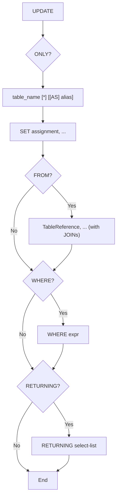

# PostgreSQL Parser Specification

Defines the specification for the PostgreSQL 13+ DML lexer/parser being built
in `internal/sqlfmt/pgast/` and `internal/sqlfmt/pgparser/`, tracked by
[epic #76](https://github.com/Eagle-Konbu/sanat/issues/76). It mirrors the
MySQL parser described in [parser-spec.md](parser-spec.md); this document is
filled in incrementally as each statement parser lands.

## Package Layout

```text
internal/sqlfmt/
├── pgast/     AST node types + String() fallback serialization (no parsing logic)
└── pgparser/  Lexer + recursive-descent parser producing pgast nodes
```

## Lexer

Implemented in `internal/sqlfmt/pgparser/lexer.go` and `token.go`
([#79](https://github.com/Eagle-Konbu/sanat/issues/79)). `pgparser.New(input)`
returns a `*Lexer` whose `Next()` yields one `Token` (type, literal, and
1-based line/column position) at a time, ending with `EOF`, or a `*LexError`
for malformed input.

- **Identifiers**: an unquoted identifier starts with an ASCII letter, `_`, or
  any non-ASCII character, and may continue with those, digits, and `$`. As in
  PostgreSQL's scanner, every character from U+0080 up counts, including
  combining marks and symbols. It is folded to lower case, as
  PostgreSQL does, unless it is a keyword (see [Keywords](#keywords)). A
  double-quoted identifier (`QuotedIdent`) keeps its case, and `""` inside it
  is a literal `"`.
- **Strings**: `'...'` with `''` escaping, assuming
  `standard_conforming_strings = on` (no backslash escapes); `E'...'` with
  backslash escapes, including `\xHH`, octal, and `\uXXXX`/`\UXXXXXXXX`
  (a UTF-16 surrogate pair is combined); and dollar-quoted `$$...$$` or
  `$tag$...$tag$`. An escape that denotes a zero byte (`E'\0'`, `E'\x00'`,
  `E'\u0000'`) is a `*LexError`, since PostgreSQL text cannot hold one.
  Adjacent string constants separated by whitespace that
  contains a newline are joined, per PostgreSQL's continuation rule. The
  `STRING` token's literal is the decoded content.
- **Bit strings and national strings**: `B'0101'` and `X'1F'` lex as one
  `BitString` token whose literal is the constant's SQL text with an
  upper-case prefix; a digit outside the prefix's base is a `*LexError`.
  `N'...'` lexes as a `NationalString` token holding the decoded content, and
  renders back as `N'...'`.
- **Numbers**: integers (`INT`) and decimals with an optional fraction and
  exponent (`FLOAT`), including a leading-dot `.5` and a trailing-dot `1.`;
  `1..2` leaves `..` intact. Like PostgreSQL 15+, an identifier character
  directly after a number (`123abc`, `1.col`, `0x1F`) is a `*LexError`
  ("trailing junk"), not a number followed by an alias.
- **Placeholders**: `$1`, `$2`, ... (`Placeholder`, literal without the `$`).
  `$1abc` is a `*LexError`.
- **Whitespace**: space, tab, newline, carriage return, form feed, and
  vertical tab.
- **Comments**: `--` to end of line (no space required after the dashes) and
  nesting `/* ... */` block comments are skipped.
- **Operators** follow PostgreSQL's scanner (`scan.l`): the longest run of
  operator characters ``~ ! @ # ^ & | ` ? + - * / % < > =`` is one
  operator, cut short where a `--` or `/*` comment starts. A multi-character
  operator may not end in `+` or `-` unless it also contains one of
  ``~ ! @ # ^ & | ` ? %``, so `a=-1` lexes as `a`, `=`, `-`, `1`, while `@-`
  stays one operator. The SQL operators with a precedence or meaning of their
  own keep dedicated tokens (`=`, `<>`/`!=`, `<`, `>`, `<=`, `>=`, `+`, `-`,
  `*`, `/`, `%`, `^`, and `=>`); every other operator — `||`, `~`, `->`,
  `@>`, `<->`, a user-defined one, and so on — is a generic `Op` token whose
  literal is its text. `::` and `:=` are separate tokens.

Not supported:

- `U&'...'` Unicode-escape strings and `U&"..."` identifiers, rejected with a
  dedicated `*LexError` rather than read as `u & '...'`.
- PostgreSQL 16's non-decimal integer literals (`0x1F`, `0o17`, `0b101`) and
  digit separators (`1_000`), rejected as trailing junk, as PostgreSQL 15
  does.

## Keywords

Implemented in `internal/sqlfmt/pgparser/keyword.go`
([#130](https://github.com/Eagle-Konbu/sanat/issues/130)). The lexer turns
every keyword into its own token type, and `keywordClasses` assigns each one
the category and `BARE_LABEL` flag PostgreSQL 18's `kwlist.h` gives it. A
keyword without an entry panics at package initialization, so a new keyword
cannot skip classification.

Where a keyword may also be a name follows PostgreSQL's grammar:

| Category | Example keywords | Column/table name (`ColId`) | Function/type name (`type_function_name`) |
|---|---|---|---|
| unreserved | `key`, `first`, `current`, `set` | yes | yes |
| col_name | `values`, `between`, `row` | yes | no |
| type_func_name | `left`, `join`, `like` | no | yes |
| reserved | `select`, `from`, `where` | no | no |

- **`ColId`** names columns, tables, table aliases (with or without `AS`),
  CTEs, windows, column lists, and `SET` targets. Every clause that can follow
  a table reference starts with a reserved or type_func_name keyword, so an
  implicit table alias is never confused with one. The exceptions PostgreSQL
  resolves by precedence are handled explicitly: a bare `SET` is never a DML
  target alias, and `PARTITION`, `RANGE`, `ROWS`, and `GROUPS` at the start of
  a window specification are clause keywords, not a base window name.
- **`type_function_name`** names an unqualified function (so `left(s, 2)`
  parses while `left` alone is not a column) and a cast's type.
- **`ColLabel`** — any keyword — is accepted after `AS` in a select list or
  `RETURNING`, and as a name after a dot (`t.from`, `s.select(...)`).
- **`BareColLabel`** — an identifier or a keyword marked `BARE_LABEL` — is
  accepted as a select-list alias without `AS`, so `SELECT 1 first` parses
  while `SELECT 1 over` does not. Select-list aliases always render with
  `AS`.

A keyword used as a name is folded to lower case, like an unquoted
identifier. Keywords that start a construct (`CASE`, `EXISTS`, `CAST`,
`ARRAY`, `ROW`, and the `GROUP BY` and window-frame keywords) are dispatched
before the name rules apply. `EXISTS` and `ROW` start their constructs only
when `(` follows; otherwise they are column names (`SELECT row FROM t`).

## AST (`pgast`)

`internal/sqlfmt/pgast` ([#78](https://github.com/Eagle-Konbu/sanat/issues/78))
holds the node types and a `String()` rendering for each, with no parsing
logic. `String()` is a canonical single-line SQL rendering — keywords upper
case, single spaces, aliases normalized as described per grammar below —
used as the parser's round-trip form in tests; it is not the formatter's
output layout.

| File | Contents |
|---|---|
| `node.go` | The sealed interfaces (`Statement`, `Expr`, `TableExpr`, `SimpleTableExpr`, `SelectExpr`, `InsertRows`, `MergeAction`) and identifier types (`ColIdent`, `TableIdent`, `TableName`, `Columns`) |
| `statement.go` | `Select`, `SetOp`, `Insert`, `Update`, `Delete`, `Merge` and their parts (`With`, `CommonTableExpr`, `Values`, `MergeWhen`, the `Merge*` actions, `Overriding`) |
| `expr.go` | Expressions: predicates, arithmetic, `OperatorExpr`, `FuncExpr`, `NamedArgExpr`, `CaseExpr`, casts, arrays, subqueries, literals, column references |
| `clause.go` | Clauses: `Where`, `GroupBy` (with grouping sets), `OrderBy`, `Limit`/`Offset`/`Fetch`, `Lock`, windows, `Returning`, `UpdateExpr`, `OnConflict`, `JoinCondition` |
| `table.go` | FROM items: `AliasedTableExpr`, `JoinTableExpr`, `ParenTableExpr`, `DerivedTable`, and select items `AliasedExpr`, `StarExpr` |
| `typename.go` | `TypeName` (casts and typed literals) and `TypedLiteral` |
| `markers.go` | The empty marker methods that seal the interfaces |

Identifiers are stored as SQL text: an unquoted name in its folded lower
case, a quoted one with its double quotes. Every statement's `With` field
holds its leading `WITH` clause.

**MERGE** (PostgreSQL 15+; parsed by
[#87](https://github.com/Eagle-Konbu/sanat/issues/87)): `Merge.Target` is an
`*AliasedTableExpr` (so it carries `ONLY` and `*`), and each `MergeWhen` pairs
a `MergeMatchKind` — `MATCHED`, `NOT MATCHED`, `NOT MATCHED BY TARGET`, or
`NOT MATCHED BY SOURCE` (the last two PostgreSQL 17+) — with a `MergeAction`:
`*MergeUpdate`, `MergeDelete`, `*MergeInsert` (columns, `OVERRIDING
{SYSTEM | USER} VALUE`, and `VALUES (...)` or, when `Values` is nil,
`DEFAULT VALUES`), or `MergeDoNothing`. `Merge.Returning` (PostgreSQL 17+)
uses the shared `Returning`, whose `Aliases` hold PostgreSQL 18's
`RETURNING WITH (OLD AS ..., NEW AS ...)`.

## Statement Entry Point

Implemented in `internal/sqlfmt/pgparser/statement.go`
([#130](https://github.com/Eagle-Konbu/sanat/issues/130)):

```go
func ParseStatement(input string) (pgast.Statement, error)
```

`ParseStatement` parses one statement of any supported kind: a query (a
`SELECT` or set operation, optionally parenthesized), `INSERT`, `UPDATE`, or
`DELETE`. It reads an optional leading `WITH` clause first, then dispatches on
the next keyword; any other token is parsed as a query, so it fails as one.

The per-kind entry points `ParseSelect`, `ParseInsert`, `ParseUpdate`, and
`ParseDelete` share the same plumbing and accept a leading `WITH` the same
way; `ParseSetOp` additionally requires a set operator. All of them fully
consume `input`, accepting one optional trailing `;` and failing with a
`*ParseError` (or `*LexError`) otherwise. `ParseExpr` parses a bare
expression and accepts no `;`.

Every statement form, including a CTE body and a subquery, reads its `WITH`
clause through one path, which attaches it to the parsed statement's `With`
field. A statement kind that cannot carry a `WITH` is a `*ParseError`, never
a panic.

`internal/sqlfmt/pgparser/statement_test.go` holds table-driven tests for
dispatch to each statement kind, with and without a leading `WITH`, and for
errors.

## Expression Grammar

Implemented in `internal/sqlfmt/pgparser/expr.go`
([#80](https://github.com/Eagle-Konbu/sanat/issues/80)). The entry point
`ParseExpr(input string) (pgast.Expr, error)` parses one expression and
accepts no trailing `;`.

### Precedence

Loosest to tightest, matching PostgreSQL's operator precedence table:

| Level | Operators | Associativity | Node |
|---|---|---|---|
| 1 | `OR` | left | `OrExpr` |
| 2 | `AND` | left | `AndExpr` |
| 3 | `NOT` | right (prefix) | `NotExpr` |
| 4 | `IS [NOT] {NULL \| TRUE \| FALSE \| UNKNOWN \| DISTINCT FROM}`, `ISNULL`, `NOTNULL` | postfix | `IsExpr`, `IsTruthExpr`, `IsDistinctFromExpr` |
| 5 | `=` `<>` `<` `>` `<=` `>=` | non-associative (`a = b = c` is an error) | `ComparisonExpr` |
| 6 | `[NOT] IN`, `[NOT] BETWEEN [SYMMETRIC]`, `[NOT] LIKE`, `[NOT] ILIKE`, `[NOT] SIMILAR TO` (with `ESCAPE`) | non-associative | `ComparisonExpr`, `RangeCond`, `ILikeExpr` |
| 7 | every other operator (`Op` tokens such as `\|\|`, `~`, `->`, `@>`, `<->`) and `OPERATOR([schema.]op)` | left (infix); prefix | `OperatorExpr` |
| 8 | `+` `-` | left | `ArithmeticExpr` |
| 9 | `*` `/` `%` | left | `ArithmeticExpr` |
| 10 | `^` | left (`2 ^ 3 ^ 2` is `(2 ^ 3) ^ 2`) | `ArithmeticExpr` |
| 11 | `AT TIME ZONE` | left | `AtTimeZoneExpr` |
| 12 | `COLLATE` | left (postfix) | `CollateExpr` |
| 13 | unary `+` `-` | right (prefix) | `UnaryExpr` |
| 14 | `::type` | left (postfix) | `CastExpr` |
| 15 | `[i]`, `[a:b]` | postfix | `ArraySubscriptExpr` |

**Generic operators** (level 7) are not listed one by one: any operator the
lexer produces as `Op` is accepted, so new or user-defined operators parse
without parser changes. As a prefix operator, its operand extends over `+`
and `-` and tighter operators, as in PostgreSQL: `~ a + b` is `~ (a + b)`,
while `~ a || b` is `(~ a) || b`. `OPERATOR(schema.op)` applies any operator,
including a fixed one such as `+`, at this level, and renders as written.
Prefix `OPERATOR(...)` is not supported, since `operator(...)` is also a
valid function call.

A prefix operator renders with a space before its operand when the operand
starts with an operator character, since `- -a` would otherwise render as
the comment `--a`.

### Primary Expressions

- Literals: numbers, strings (rendered back as `'...'`), `NULL`, `TRUE`,
  `FALSE`, and placeholders (`$1`).
- Column references `name` and `qualifier.name`, and function calls
  `[qualifier.]name(args)` with `*`, `DISTINCT`, named arguments
  (`name => value`, or the older `name := value`), `FILTER (WHERE ...)`, and
  `OVER window_name` or `OVER (window specification)`.
- Parenthesized expressions, row values `(a, b)`, `ROW(...)`, scalar
  subqueries, and `EXISTS (subquery)`.
- `CASE` (simple and searched), `CAST(expr AS type)`, and `ARRAY[...]`.
- Typed literals, a type name followed by a string constant:
  `date '2020-01-01'`, `varchar(3) 'abc'`, `pg_catalog.int4 '1'`,
  `double precision '1.5'`, `interval '1' day`, `interval(2) '1.5'`
  (`pgast.TypedLiteral`). A type name can't be told apart from a column or
  function call until the string after it, so the parser parses it
  speculatively and backtracks when no string follows.

- Quantified comparisons `left op {ANY | SOME | ALL} (array | subquery)`
  (`pgast.QuantifiedExpr`), where `op` is a comparison or generic operator,
  `OPERATOR(...)`, or `[NOT] LIKE`/`ILIKE`. `ANY` and `SOME` are reserved
  keywords, so `any(arr)` alone is not a function call.
- `expr COLLATE collation` (`CollateExpr`) and `expr AT TIME ZONE zone`
  (`AtTimeZoneExpr`; `AT`, `TIME`, and `ZONE` are matched as identifiers).
- `[NOT] SIMILAR TO pattern [ESCAPE e]` (a `ComparisonExpr` with
  `SimilarOp`/`NotSimilarOp`), `[NOT] BETWEEN SYMMETRIC` (an explicit
  `ASYMMETRIC` is the default and is dropped), and
  `IS [NOT] [NFC | NFD | NFKC | NFKD] NORMALIZED` (`IsNormalizedExpr`).
- `ARRAY(subquery)` (`ArraySubquery`) and multidimensional
  `ARRAY[[1, 2], [3, 4]]`, whose inner brackets are `ArrayExpr`s with
  `Nested` set.

- Function call arguments: an aggregate's `ORDER BY` inside the parentheses
  (`FuncExpr.OrderBy`), `WITHIN GROUP (ORDER BY ...)`
  (`FuncExpr.WithinGroup`), `VARIADIC` on the last argument
  (`FuncExpr.Variadic`), and the no-op `ALL` modifier, which is dropped like
  `SELECT ALL`.
- SQL-standard keyword-argument forms, each with its own node in
  `pgast/funcform.go`: `EXTRACT(field FROM d)`, `SUBSTRING(s FROM a FOR b)`
  (`FOR ... FROM` renders as `FROM ... FOR`) and
  `SUBSTRING(s SIMILAR p ESCAPE e)`, `POSITION(a IN b)`,
  `TRIM([BOTH | LEADING | TRAILING] [chars] FROM s)`, and
  `OVERLAY(s PLACING r FROM a [FOR b])`. The comma-separated spellings of
  `SUBSTRING`, `TRIM`, and `OVERLAY` are ordinary `FuncExpr`s, while
  `EXTRACT` requires `FROM` and `POSITION` requires `IN`. These forms are
  also accepted as `FROM` items and in `ON CONFLICT` targets.
- `(a, b) OVERLAPS (c, d)` (`OverlapsExpr`); both sides must be two-element
  rows.
- Column references of up to three parts (`schema.table.col`), whole-row
  references (`t.*`, as in `count(t.*)`), and field selection
  (`FieldSelectExpr`): `(expr).field`, `(expr).*`, `arr[1].f`, and dotted
  references beyond three parts. As in PostgreSQL, a function call's result
  must be parenthesized before selecting a field.

Not supported (each a `*ParseError` unless noted): `IS [NOT] DOCUMENT`,
`AT LOCAL`, `COLLATION FOR (...)`, and three-part function names
(`db.schema.f()`).

### Type Names

Implemented in `internal/sqlfmt/pgparser/typename.go`
([#131](https://github.com/Eagle-Konbu/sanat/issues/131)). Casts
(`expr::type`, `CAST(expr AS type)`) and typed literals share one type-name
grammar, producing a structured `pgast.TypeName` (in `pgast/typename.go`):

| Field | Holds | Example |
|---|---|---|
| `Names` | the dotted name parts; a built-in multi-word name is one part | `public.mytype`, `double precision` |
| `Modifiers` | constants or plain identifiers | `numeric(10, 2)`, `geometry(point, 4326)` |
| `TimeZone` | `WITH` / `WITHOUT TIME ZONE` | `timestamp(3) with time zone` |
| `IntervalFields` | an interval's field restriction, as text | `interval day to second(3)` |
| `ArrayBounds` | one entry per `[]` / `[n]` | `int[][3]` |

`CastExpr.Type` is a `*pgast.TypeName` rather than an opaque string, so later
grammar (such as column definition lists) and the formatter can use its
parts. Type names render in lower case, as PostgreSQL's documentation spells
them.

- **Built-in multi-word names**: `double precision`; `character`, `char`,
  `nchar`, `national character`, and `national char`, each optionally
  followed by `varying`; `bit [varying]`; `time` and `timestamp` with an
  optional precision and `with time zone` / `without time zone`; and
  `interval` with either a precision or a field restriction (`year`,
  `month`, `day`, `hour`, `minute`, `second[(p)]`, optionally `field TO
  field`). PostgreSQL makes these words keywords; here they stay identifiers
  matched by their text at these positions, so they remain usable as names
  elsewhere. An interval field after a cast is always a field, never an
  alias, as in PostgreSQL.
- **Modifiers** accept only integer, numeric, and string constants and plain
  identifiers, which is all PostgreSQL accepts at analysis.
- Not supported: the `ARRAY` keyword spelling of array types
  (`int ARRAY[3]`) and `SETOF`.

## SELECT Statement Grammar

Implemented in `internal/sqlfmt/pgparser/select.go`
([#81](https://github.com/Eagle-Konbu/sanat/issues/81));
entry point `ParseSelect(input string) (*pgast.Select, error)`.

```text
[ WITH [ RECURSIVE ] with_query [, ...] ]
SELECT [ ALL | DISTINCT [ ON ( expr [, ...] ) ] ]
    { * | table.* | expr [ [ AS ] output_name ] } [, ...]
    [ FROM from_item [, ...] ]
    [ WHERE condition ]
    [ GROUP BY grouping_element [, ...] ]
    [ HAVING condition ]
    [ WINDOW window_name AS ( window_definition ) [, ...] ]
    [ ORDER BY expr [ ASC | DESC ] [ NULLS { FIRST | LAST } ] [, ...] ]
    [ LIMIT { count | ALL } ] [ OFFSET start [ ROW | ROWS ] ]
    [ FETCH { FIRST | NEXT } [ count ] { ROW | ROWS } { ONLY | WITH TIES } ]
    [ FOR { UPDATE | NO KEY UPDATE | SHARE | KEY SHARE }
          [ OF table_name [, ...] ] [ NOWAIT | SKIP LOCKED ] [...] ]
```

- **Select list**: `*`, `table.*`, `schema.table.*`, or an expression with an
  optional alias; aliases always render with `AS` (see
  [Keywords](#keywords) for which names need it).
- **FROM items**: tables (`[schema.]name`), derived tables
  `(subquery) [AS] alias`, `LATERAL (subquery)`, parenthesized join trees,
  comma lists, and `[INNER] JOIN`, `LEFT`/`RIGHT`/`FULL [OUTER] JOIN` (each
  requiring `ON` or `USING (cols)`), `CROSS JOIN`, and `NATURAL` joins.
- **GROUP BY** elements: expressions, `()`, `GROUPING SETS (...)`,
  `CUBE (...)`, and `ROLLUP (...)`.
- **Window definitions**: an optional base window name, `PARTITION BY`,
  `ORDER BY`, and a `ROWS`/`RANGE`/`GROUPS` frame with
  `UNBOUNDED PRECEDING`/`FOLLOWING`, `CURRENT ROW`, or `expr PRECEDING`/
  `FOLLOWING` bounds.
- **Row limiting**: `LIMIT` and `OFFSET` each at most once, in either order;
  `FETCH` may not be combined with `LIMIT`.

- **Function FROM items** ([#131](https://github.com/Eagle-Konbu/sanat/issues/131)):
  `func(...)`, `LATERAL func(...)`, and `ROWS FROM (func(...), ...)`, each
  optionally `WITH ORDINALITY`, as a `pgast.FuncTable` inside an
  `AliasedTableExpr`.
- **Alias column lists**: `AS t(a, b)` on tables, derived tables, function
  calls, and parenthesized joins (`Columns`).
- **`TABLESAMPLE method (args) [REPEATABLE (seed)]`** after a table's alias
  (`AliasedTableExpr.Sample`). `TABLESAMPLE` is a type_func_name keyword, so
  it is never read as an alias.
- **`ONLY name`, `ONLY (name)`, and `name *`**, as for DML targets.
- **Nested joins**: a join that still needs its `ON`/`USING` lets its right
  side absorb the joins that follow, so `a JOIN b JOIN c ON x ON y` is
  `a JOIN (b JOIN c ON x) ON y`, as in PostgreSQL. `JOIN ... USING (cols)
  AS alias` (PostgreSQL 14+) sets `JoinCondition.UsingAlias`.
- **`VALUES` and `TABLE name` queries**: like PostgreSQL's parse tree, both
  are a `pgast.Select`, with `Values` (the rows) or `Table` (the relation)
  set, so they work at the top level, as set-operation operands, in every
  subquery position, as CTE bodies, and with trailing `ORDER BY`/`LIMIT`.
  `VALUES` starts a query only when `(` follows, since it is also a
  col_name keyword.
- **Empty select list**: `SELECT FROM t` and a bare `SELECT` (not after
  `DISTINCT`).
- **Window frame `EXCLUDE CURRENT ROW | GROUP | TIES | NO OTHERS`**
  (`FrameClause.Exclude`) and **`ORDER BY expr USING op`** (`Order.Using`),
  in every sort clause.

Not supported: column definition lists for functions returning `record`
(`f() AS t(a int)`), `SELECT INTO`, and `GROUP BY ALL`/`DISTINCT`.

## Shared DML Grammar

`internal/sqlfmt/pgparser/dml.go`
([#130](https://github.com/Eagle-Konbu/sanat/issues/130)) holds the pieces
that `INSERT`, `UPDATE`, and `DELETE` share, and that `MERGE`'s actions reuse:

- **Target relation** (`parseRelationExpr`): `[ ONLY ] table_name [ * ] [ [ AS ] alias ]`,
  parsed into an `*pgast.AliasedTableExpr` by `UPDATE` and `DELETE`. `ONLY`
  sets `Only`; an explicit `*` (include inheritance descendants, already the
  default) sets `IncludeDescendants` so it round-trips as written. The two are
  mutually exclusive, as in PostgreSQL. `ONLY (table_name)` is accepted and
  normalized to `ONLY table_name`. The alias renders without `AS`, like table
  aliases in `SELECT`. A bare `SET` is never taken as the alias, as in
  PostgreSQL, so `AS set` is accepted and keeps its `AS` when rendered.
- **SET assignment list** (`parseSetClauseList`), used by `UPDATE` and
  `ON CONFLICT DO UPDATE`; see [UPDATE](#update-statement-grammar) for its
  forms.
- **A single `VALUES` row** (`parseParenExprOrDefaultList`):
  `( { expr | DEFAULT } [, ...] )`, used per row by `INSERT ... VALUES` and by
  `ROW(...)` sources in `SET`.
- **Optional column list** (`parseOptionalParenColumnList`), used after an
  `INSERT` target, by `ON CONFLICT`, and by CTE names.
- **`RETURNING`** (`parseOptionalReturning`).

## INSERT Statement Grammar

Implemented in `internal/sqlfmt/pgparser/insert.go`
([#82](https://github.com/Eagle-Konbu/sanat/issues/82)):

```go
func ParseInsert(input string) (*pgast.Insert, error)
```

Like `ParseSelect`, it fully consumes `input`, accepting one optional trailing
`;` and failing with a `*ParseError` (or `*LexError`) otherwise.

```text
[ WITH [ RECURSIVE ] with_query [, ...] ]
INSERT INTO table_name [ AS alias ] [ ( column [, ...] ) ]
    { DEFAULT VALUES | VALUES ( { expr | DEFAULT } [, ...] ) [, ...] | select }
    [ ON CONFLICT { [ ( column [, ...] ) ] DO NOTHING
                  | ( column [, ...] ) DO UPDATE SET set_clause [, ...]
                        [ WHERE condition ] } ]
    [ RETURNING { * | output_expr [ [ AS ] output_name ] } [, ...] ]
```

- **Target alias**: PostgreSQL requires `AS` before an `INSERT` target alias
  (unlike a `FROM` item), so `INSERT INTO t x ...` is rejected. The target is
  a different production from the other DML targets — no `ONLY` or `*`, and
  `AS` is mandatory — so `pgast.Insert` stores it as `Table` plus `Alias`
  (rendered with `AS`) rather than as an `*pgast.AliasedTableExpr`.
- **`DO UPDATE SET`** shares `UPDATE`'s `SET` grammar, including multi-column
  `(a, b) = (...)`, `ROW(...)`, and sub-SELECT sources.
- **`DEFAULT`**: accepted only as a `VALUES` item or as the right-hand side of
  a `DO UPDATE SET` assignment, not as a general expression. It is modeled as
  a `pgast.Literal` rendered verbatim.
- **`select`** row source: a query (`parseQuery`) — a `SELECT` or a set
  operation, stored in `Insert.Rows` as a `pgast.Select` or `pgast.SetOp` —
  which may lead with its own `WITH` clause.
- **Conflict target**: optional for `DO NOTHING`, required for `DO UPDATE`.
  PostgreSQL rejects a `DO UPDATE` without a target during analysis, not in
  its grammar, but no input with one is valid, so it fails at parse time here.
- **`EXCLUDED.col`**: needs no special handling — it parses as an ordinary
  column reference qualified by the `EXCLUDED` pseudo-table, inside the
  `DO UPDATE SET` and `WHERE` expressions.
- **`RETURNING`** reuses the `SELECT` list grammar (`*`, `table.*`, and
  `expr [[AS] name]`); `String()` always renders an alias with `AS`.

- **Conflict targets** ([#131](https://github.com/Eagle-Konbu/sanat/issues/131)):
  `ON CONSTRAINT name` (`OnConflict.Constraint`), or a list of
  `pgast.IndexElem`s (`OnConflict.Target`) — a column, function call, or
  parenthesized expression, each with an optional `COLLATE` and operator
  class — followed by an optional `WHERE index_predicate`
  (`OnConflict.TargetWhere`).
- **Column list**: each column may carry indirection (`arr[1]`,
  `c.field`), as with `UPDATE`'s `SET` targets, so `Insert.Columns` is a
  list of target expressions.
- **Parenthesized query source**: `INSERT INTO t (SELECT ...)` is told apart
  from a column list by the token after `(`. A `VALUES` source followed by a
  set operator or trailing clause continues as a query, and `TABLE name` is
  accepted.

Not yet implemented: `OVERRIDING { SYSTEM | USER } VALUE` and PostgreSQL
18's `RETURNING WITH (...)`.

## UPDATE Statement Grammar

Entry point: `pgparser.ParseUpdate(input string) (*pgast.Update, error)`,
implemented in `internal/sqlfmt/pgparser/update.go`. A single trailing `;` is
accepted; any other trailing input is an error.

```text
[ WITH [ RECURSIVE ] with_query [, ...] ]
UPDATE [ ONLY ] table_name [ * ] [ [ AS ] alias ]
    SET { column = { expr | DEFAULT }
        | ( column [, ...] ) = { ( { expr | DEFAULT } [, ...] )
                               | ROW ( { expr | DEFAULT } [, ...] )
                               | ( sub-SELECT ) }
        } [, ...]
    [ FROM from_item [, ...] ]
    [ WHERE condition ]
    [ RETURNING { * | output_expr [ [ AS ] output_name ] } [, ...] ]
```



**Target table.** `Update.Table` is an `*pgast.AliasedTableExpr` parsed by
the shared [target relation](#shared-dml-grammar) grammar, the same as
`DELETE`'s.

**SET assignments** are `pgast.UpdateExpr` values:

- `column = expr` sets `Name`. The right-hand side may be any expression,
  including a parenthesized row such as `(1, 'x')` for a composite column,
  or the `DEFAULT` keyword (a `pgast.Literal`, as in `INSERT`). A target may carry one dotted
  level (`col.field`), naming a composite-type field; PostgreSQL rejects a
  table-qualified target but the parser does not distinguish the two.
- `(column, ...) = source` sets `Names`. The source must be a parenthesized
  value list (`pgast.ValTuple`), a `ROW(...)` constructor (`pgast.RowExpr`),
  or a parenthesized sub-SELECT (`pgast.Subquery`); value lists and `ROW`
  elements may contain `DEFAULT`. Any other source is a parse error.

**FROM** reuses the `SELECT` table-reference grammar (comma lists, joins,
derived tables). It is PostgreSQL's way of joining the target against other
tables for use in `SET`/`WHERE`, and is unrelated to MySQL's comma-joined
multi-table `UPDATE` target, so the two parsers share no logic.

**RETURNING** reuses the `SELECT` list grammar (`*`, `table.*`,
`expr [[AS] name]`) and produces a `pgast.Returning`.

**Not supported:**

- `WHERE CURRENT OF cursor_name`, which needs `DECLARE CURSOR` session state;
  it is rejected with an explicit error.
- `RETURNING WITH (OLD/NEW AS ...)` (PostgreSQL 18 only).
- MySQL-only clauses such as `ORDER BY`/`LIMIT` are rejected as trailing
  input.

## DELETE Statement Grammar

Implemented in `internal/sqlfmt/pgparser/delete.go`
([#84](https://github.com/Eagle-Konbu/sanat/issues/84)).

```go
func ParseDelete(input string) (*pgast.Delete, error)
```

```
[ WITH [ RECURSIVE ] with_query [, ...] ]
DELETE FROM [ ONLY ] table_name [ * ] [ [ AS ] alias ]
    [ USING from_item [, ...] ]
    [ WHERE condition ]
    [ RETURNING { * | output_expr [ [ AS ] output_name ] } [, ...] ]
```

`ParseDelete` fully consumes `input`, accepting one optional trailing `;`
and failing with a `*ParseError` on any other trailing token. Malformed input
reached during lookahead may fail with a `*LexError` instead.

**Target table**: an optionally schema-qualified name, parsed into
`pgast.Delete.Table` (an `*pgast.AliasedTableExpr`) by the shared
[target relation](#shared-dml-grammar) grammar, so `ONLY`, `*`, and the alias
behave exactly as for `UPDATE`.

**`USING`** is PostgreSQL's mechanism for joining other tables into a
`DELETE`. It takes the same `from_item` list as `SELECT`'s `FROM` clause
(comma lists, `JOIN` variants, parenthesized and derived tables), sharing
`parseTableReferenceList`. This is new grammar, not a port of the MySQL
parser's multi-table `DELETE t1 FROM t1, t2 ...` form.

**`RETURNING`** reuses the `SELECT` list grammar (`*`, `table.*`, and
`expr [[AS] name]`) and is stored as `pgast.Returning`.

PostgreSQL has no `ORDER BY` or `LIMIT` on `DELETE`, so both are rejected as
trailing tokens.

Deferred:

- `WHERE CURRENT OF cursor_name` — it needs `DECLARE CURSOR` session state a
  formatter never has; it currently fails to parse.
- `RETURNING WITH (OLD/NEW AS ...)` — PostgreSQL 18 only.

## Set Operation Grammar

Implemented in `internal/sqlfmt/pgparser/setop.go`
([#85](https://github.com/Eagle-Konbu/sanat/issues/85)).

### Entry Point

```go
func ParseSetOp(input string) (*pgast.SetOp, error)
```

`ParseSetOp` parses two or more SELECT operands combined by set operators,
plus any trailing clauses on the combined result, and an optional trailing
`;`. It fails with a `*ParseError` when the input is a single (possibly
parenthesized) SELECT with no set operator. Use `ParseSelect` only for an
unparenthesized single `SELECT`, `VALUES`, or `TABLE` query, optionally
preceded by `WITH`: it rejects a leading `(` and a top-level set operation.

### Grammar

```
query      := [ with_clause ] union_term trailing
union_term := intersect_term { ( UNION | EXCEPT ) [ ALL | DISTINCT ] intersect_term }
intersect_term := operand { INTERSECT [ ALL | DISTINCT ] operand }
operand    := simple_select | "(" query ")"
trailing   := [ ORDER BY ... ] [ row_limit ] { FOR ... }
row_limit  := LIMIT ... [ OFFSET ... ]
            | OFFSET ... [ LIMIT ... | FETCH ... ]
            | FETCH ...
```

- `simple_select` is a SELECT from the `SELECT` keyword through its
  `WINDOW` clause. A bare operand cannot carry its own `ORDER BY`/`LIMIT`/
  `OFFSET`/`FETCH`/locking clause; wrap it in parentheses to scope one to it,
  as PostgreSQL requires.
- Precedence follows PostgreSQL: `INTERSECT` binds tighter than `UNION` and
  `EXCEPT`, which share a precedence level. All three associate left, so
  `a UNION b INTERSECT c` is `a UNION (b INTERSECT c)` and
  `a UNION b EXCEPT c` is `(a UNION b) EXCEPT c`. Each operator becomes one
  `pgast.SetOp{Left, Op, All, Right}` node.
- `DISTINCT` is the default quantifier and is not modeled separately: an
  explicit `DISTINCT` renders as the bare operator.
- Trailing clauses after the operator chain apply to the whole set
  operation and are stored on the outermost `SetOp`.
- A trailing clause after a parenthesized query is attached to that query,
  so `(a UNION b) ORDER BY 1` is a single `SetOp` with `OrderBy` set, and
  `(SELECT 1 ORDER BY 1) LIMIT 2` is a single `Select`. Like PostgreSQL,
  giving the same clause at both levels is an error (`multiple ORDER BY
  clauses not allowed`, likewise for `LIMIT` — which `FETCH` counts as — and
  `OFFSET`).
- `LIMIT` and `OFFSET` may each appear once, in either order. `FETCH` is the
  SQL-standard spelling of `LIMIT`, so it cannot be combined with `LIMIT`.
- A locking clause (`FOR UPDATE` and friends) on a set operation, or on any
  of its operands (including a parenthesized SELECT operand such as
  `(SELECT 1 FOR UPDATE) UNION SELECT 2`), is a `*ParseError`, matching
  PostgreSQL's rejection of it; `pgast.SetOp` has no field for one. A
  locking clause inside a subquery within an operand is unaffected.
- A leading `WITH` clause (see [Common Table Expressions](#common-table-expressions))
  scopes the whole query and is stored on the outermost statement. To scope
  one to a single operand, parenthesize the operand.
- `VALUES` and `TABLE name` operands are `Select`s (see
  [SELECT](#select-statement-grammar)), so they combine like any other.

### Subquery Positions

Every parenthesized subquery position (each of which may lead with `WITH`) — scalar subqueries, `[NOT] IN (...)`,
`EXISTS (...)`, derived tables (including `LATERAL`), and comparisons
against a subquery — accepts a full `query`, not just a single SELECT. A
leading parenthesized operand such as `IN ((SELECT 1) UNION SELECT 2)` or
`FROM ((SELECT 1) UNION SELECT 2) t` cannot be told apart from a
parenthesized expression or table reference until the token after its `)`,
so those contexts parse the operand first and continue the query when a set
operator or trailing clause follows; redundant parentheses around that
operand (`FROM (((SELECT 1)) UNION SELECT 2) t`) are unwrapped first. A lone
parenthesized query such as `IN ((SELECT 1))` is a subquery, not a one-item
value list. `IN ((SELECT 1), 2)` stays a value list and
`FROM ((SELECT 1) a JOIN b ON TRUE)` stays a parenthesized join.

### Rendering

`SetOp.String()` parenthesizes an operand only when needed: a nested
`SetOp` whose grouping precedence and left associativity don't already imply,
or any operand with its own `WITH`, `ORDER BY`, `LIMIT`, `OFFSET`, `FETCH`,
or (for a SELECT) locking clause. Redundant parentheses in the input are
therefore dropped, e.g. `(SELECT 1) UNION (SELECT 2 UNION SELECT 3)` renders
as `SELECT 1 UNION (SELECT 2 UNION SELECT 3)` while
`(SELECT 1 UNION SELECT 2) UNION SELECT 3` renders as
`SELECT 1 UNION SELECT 2 UNION SELECT 3`.

### Testing

`internal/sqlfmt/pgparser/setop_test.go` holds table-driven round-trip tests
through `String()` (mirroring `select_test.go` and
`internal/sqlfmt/parser/union_test.go`), structural tests for precedence,
associativity, and trailing-clause placement, subquery-position tests via
`ParseSelect`, and error cases with positions.

## Common Table Expressions

Implemented in `internal/sqlfmt/pgparser/cte.go`
([#86](https://github.com/Eagle-Konbu/sanat/issues/86)). There is no
separate entry point: `WITH` is an optional leading clause accepted by
`ParseStatement` and each per-kind entry point (see
[Statement Entry Point](#statement-entry-point)), and by every parenthesized
subquery position.

### Grammar

```
with_clause := WITH [ RECURSIVE ] with_query [, ...]
with_query  := cte_name [ ( column [, ...] ) ] AS [ [ NOT ] MATERIALIZED ]
               ( query | insert | update | delete )
```

- The clause is stored in the `With` field of the statement it leads
  (`pgast.Select`, `SetOp`, `Insert`, `Update`, or `Delete`). Each CTE is a
  `pgast.CommonTableExpr`, whose `Subquery` holds whichever statement the
  body parses to.
- **Bodies** may be a query (a `SELECT` or set operation, optionally
  parenthesized), or a data-modifying `INSERT`/`UPDATE`/`DELETE`, typically
  with `RETURNING`, as in
  `WITH deleted AS (DELETE FROM logs RETURNING *) INSERT INTO archive SELECT * FROM deleted`.
  Any body may lead with its own nested `WITH`.
- **`[NOT] MATERIALIZED`** is stored as `CommonTableExpr.Materialization`
  (`MaterializeDefault`, `Materialized`, or `NotMaterialized`) and rendered
  back as written.
- **Scope**: in a query, the `WITH` applies to the whole set-operation chain
  and its trailing clauses, so `WITH x AS (...) SELECT 1 UNION SELECT 2` stores
  it on the `SetOp`. A `WITH` on a parenthesized operand stays on that
  operand, and `SetOp.String()` keeps that operand's parentheses.
- **Multiple `WITH` clauses**: a `WITH` before a parenthesized query that has
  its own `WITH`, as in `(WITH a AS (...) (WITH b AS (...) SELECT 1))`, fails
  with `multiple WITH clauses not allowed`, as in PostgreSQL.
- **`INSERT ... SELECT`**: the query row source may lead with its own
  `WITH`, separate from the one on the `INSERT`.
- **`RECURSIVE` and `MATERIALIZED`** are keywords only at their fixed points
  in a `WITH` clause. Elsewhere they are unreserved keywords usable as names
  (see [Keywords](#keywords)), so `SELECT materialized FROM recursive`
  parses.
- Data-modifying statements are accepted only as CTE bodies (and at the top
  level), not in other subquery positions, matching PostgreSQL.

Deferred:

- `MERGE` as a CTE body
  ([#87](https://github.com/Eagle-Konbu/sanat/issues/87)).
- The `SEARCH { BREADTH | DEPTH } FIRST BY ...` and `CYCLE ...` clauses on
  recursive CTEs (PostgreSQL 14+).

### Testing

`internal/sqlfmt/pgparser/cte_test.go` holds table-driven round-trip tests
for each entry point (including DML-bodied CTEs feeding another DML
statement), `WITH` in each subquery position, structural tests for where the
clause is attached, and error cases.
