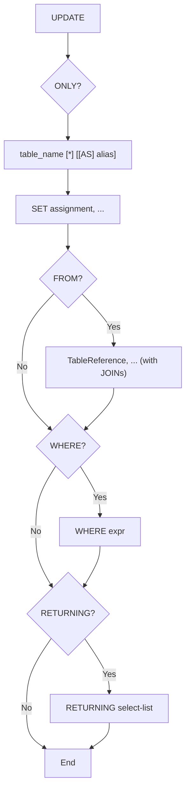

# PostgreSQL Parser Specification

Defines the specification for the PostgreSQL lexer/parser being built in
`internal/sqlfmt/pgast/` and `internal/sqlfmt/pgparser/` (epic
[#76](https://github.com/Eagle-Konbu/sanat/issues/76)). It mirrors the
structure of [parser-spec.md](parser-spec.md), the MySQL equivalent, and is
filled in incrementally as each statement parser lands.

## UPDATE Statement Grammar

Entry point: `pgparser.ParseUpdate(input string) (*pgast.Update, error)`,
implemented in `internal/sqlfmt/pgparser/update.go`. A single trailing `;` is
accepted; any other trailing input is an error.

```text
UPDATE [ ONLY ] table_name [ * ] [ [ AS ] alias ]
    SET { column = { expr | DEFAULT }
        | ( column [, ...] ) = { ( { expr | DEFAULT } [, ...] )
                               | ROW ( { expr | DEFAULT } [, ...] )
                               | ( sub-SELECT ) }
        } [, ...]
    [ FROM from_item [, ...] ]
    [ WHERE condition ]
    [ RETURNING { * | output_expr [ [ AS ] output_name ] } [, ...] ]
```



**Target table.** `ONLY` sets `Update.Only`; an explicit `*` after the table
name (include inheritance descendants, already the default) sets
`Update.Descendants` so it round-trips as written. The two are mutually
exclusive, as in PostgreSQL. `ONLY (table_name)` is accepted and normalized
to `ONLY table_name`. The alias renders without `AS`, like table aliases in
`SELECT`.

**SET assignments** are `pgast.UpdateExpr` values:

- `column = expr` sets `Name`. The right-hand side may be any expression,
  including a parenthesized row such as `(1, 'x')` for a composite column,
  or the `DEFAULT` keyword (`pgast.Default`). A target may carry one dotted
  level (`col.field`), naming a composite-type field; PostgreSQL rejects a
  table-qualified target but the parser does not distinguish the two.
- `(column, ...) = source` sets `Names`. The source must be a parenthesized
  value list (`pgast.ValTuple`), a `ROW(...)` constructor (`pgast.RowExpr`),
  or a parenthesized sub-SELECT (`pgast.Subquery`); value lists and `ROW`
  elements may contain `DEFAULT`. Any other source is a parse error.

**FROM** reuses the `SELECT` table-reference grammar (comma lists, joins,
derived tables). It is PostgreSQL's way of joining the target against other
tables for use in `SET`/`WHERE`, and is unrelated to MySQL's comma-joined
multi-table `UPDATE` target, so the two parsers share no logic.

**RETURNING** reuses the `SELECT` list grammar (`*`, `table.*`,
`expr [[AS] name]`) and produces a `pgast.Returning`.

**Not supported:**

- A leading `WITH` clause (deferred to
  [#86](https://github.com/Eagle-Konbu/sanat/issues/86)).
- `WHERE CURRENT OF cursor_name`, which needs `DECLARE CURSOR` session state;
  it is rejected with an explicit error.
- `RETURNING WITH (OLD/NEW AS ...)` (PostgreSQL 18 only).
- Array-subscript SET targets (`col[1] = ...`) and nested field targets
  (`col.a.b = ...`).
- MySQL-only clauses such as `ORDER BY`/`LIMIT` are rejected as trailing
  input.
