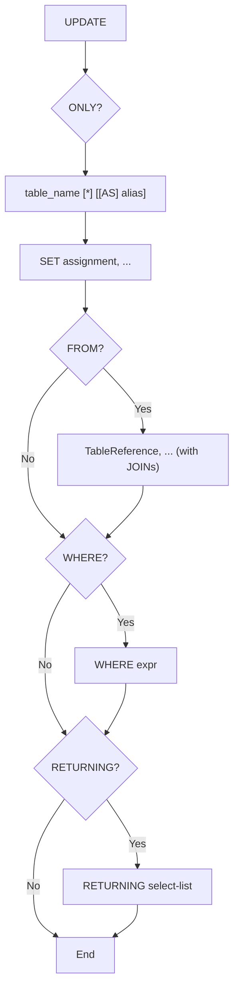

# PostgreSQL Parser Specification

Defines the specification for the PostgreSQL 13+ DML lexer/parser being built
in `internal/sqlfmt/pgast/` and `internal/sqlfmt/pgparser/`, tracked by
[epic #76](https://github.com/Eagle-Konbu/sanat/issues/76). It mirrors the
MySQL parser described in [parser-spec.md](parser-spec.md); this document is
filled in incrementally as each statement parser lands.

## Package Layout

```text
internal/sqlfmt/
├── pgast/     AST node types + String() fallback serialization (no parsing logic)
└── pgparser/  Lexer + recursive-descent parser producing pgast nodes
```

## INSERT Statement Grammar

Implemented in `internal/sqlfmt/pgparser/insert.go`
([#82](https://github.com/Eagle-Konbu/sanat/issues/82)):

```go
func ParseInsert(input string) (*pgast.Insert, error)
```

Like `ParseSelect`, it fully consumes `input`, accepting one optional trailing
`;` and failing with a `*ParseError` (or `*LexError`) otherwise.

```text
[ WITH [ RECURSIVE ] with_query [, ...] ]
INSERT INTO table_name [ AS alias ] [ ( column [, ...] ) ]
    { DEFAULT VALUES | VALUES ( { expr | DEFAULT } [, ...] ) [, ...] | select }
    [ ON CONFLICT { [ ( column [, ...] ) ] DO NOTHING
                  | ( column [, ...] ) DO UPDATE SET
                        column = { expr | DEFAULT } [, ...] [ WHERE condition ] } ]
    [ RETURNING { * | output_expr [ [ AS ] output_name ] } [, ...] ]
```

- **Target alias**: PostgreSQL requires `AS` before an `INSERT` target alias
  (unlike a `FROM` item), so `INSERT INTO t x ...` is rejected.
- **`DEFAULT`**: accepted only as a `VALUES` item or as the right-hand side of
  a `DO UPDATE SET` assignment, not as a general expression. It is modeled as
  a `pgast.Literal` rendered verbatim.
- **`select`** row source: a query (`parseQuery`) — a `SELECT` or a set
  operation, stored in `Insert.Rows` as a `pgast.Select` or `pgast.SetOp` —
  which may lead with its own `WITH` clause.
- **Conflict target**: optional for `DO NOTHING`, required for `DO UPDATE`.
  PostgreSQL rejects a `DO UPDATE` without a target during analysis, not in
  its grammar, but no input with one is valid, so it fails at parse time here.
- **`EXCLUDED.col`**: needs no special handling — it parses as an ordinary
  column reference qualified by the `EXCLUDED` pseudo-table, inside the
  `DO UPDATE SET` and `WHERE` expressions.
- **`RETURNING`** reuses the `SELECT` list grammar (`*`, `table.*`, and
  `expr [[AS] name]`); `String()` always renders an alias with `AS`.

Not yet implemented: `OVERRIDING { SYSTEM | USER } VALUE`, `ON CONFLICT ON CONSTRAINT name`,
expression/`COLLATE`/operator-class conflict targets, a
`WHERE index_predicate` on the conflict target, and PostgreSQL 18's
`RETURNING WITH (...)`.

## UPDATE Statement Grammar

Entry point: `pgparser.ParseUpdate(input string) (*pgast.Update, error)`,
implemented in `internal/sqlfmt/pgparser/update.go`. A single trailing `;` is
accepted; any other trailing input is an error.

```text
[ WITH [ RECURSIVE ] with_query [, ...] ]
UPDATE [ ONLY ] table_name [ * ] [ [ AS ] alias ]
    SET { column = { expr | DEFAULT }
        | ( column [, ...] ) = { ( { expr | DEFAULT } [, ...] )
                               | ROW ( { expr | DEFAULT } [, ...] )
                               | ( sub-SELECT ) }
        } [, ...]
    [ FROM from_item [, ...] ]
    [ WHERE condition ]
    [ RETURNING { * | output_expr [ [ AS ] output_name ] } [, ...] ]
```



**Target table.** `ONLY` sets `Update.Only`; an explicit `*` after the table
name (include inheritance descendants, already the default) sets
`Update.Descendants` so it round-trips as written. The two are mutually
exclusive, as in PostgreSQL. `ONLY (table_name)` is accepted and normalized
to `ONLY table_name`. The alias renders without `AS`, like table aliases in
`SELECT`.

**SET assignments** are `pgast.UpdateExpr` values:

- `column = expr` sets `Name`. The right-hand side may be any expression,
  including a parenthesized row such as `(1, 'x')` for a composite column,
  or the `DEFAULT` keyword (a `pgast.Literal`, as in `INSERT`). A target may carry one dotted
  level (`col.field`), naming a composite-type field; PostgreSQL rejects a
  table-qualified target but the parser does not distinguish the two.
- `(column, ...) = source` sets `Names`. The source must be a parenthesized
  value list (`pgast.ValTuple`), a `ROW(...)` constructor (`pgast.RowExpr`),
  or a parenthesized sub-SELECT (`pgast.Subquery`); value lists and `ROW`
  elements may contain `DEFAULT`. Any other source is a parse error.

**FROM** reuses the `SELECT` table-reference grammar (comma lists, joins,
derived tables). It is PostgreSQL's way of joining the target against other
tables for use in `SET`/`WHERE`, and is unrelated to MySQL's comma-joined
multi-table `UPDATE` target, so the two parsers share no logic.

**RETURNING** reuses the `SELECT` list grammar (`*`, `table.*`,
`expr [[AS] name]`) and produces a `pgast.Returning`.

**Not supported:**

- `WHERE CURRENT OF cursor_name`, which needs `DECLARE CURSOR` session state;
  it is rejected with an explicit error.
- `RETURNING WITH (OLD/NEW AS ...)` (PostgreSQL 18 only).
- Array-subscript SET targets (`col[1] = ...`) and nested field targets
  (`col.a.b = ...`).
- MySQL-only clauses such as `ORDER BY`/`LIMIT` are rejected as trailing
  input.

## DELETE Statement Grammar

Implemented in `internal/sqlfmt/pgparser/delete.go`
([#84](https://github.com/Eagle-Konbu/sanat/issues/84)).

```go
func ParseDelete(input string) (*pgast.Delete, error)
```

```
[ WITH [ RECURSIVE ] with_query [, ...] ]
DELETE FROM [ ONLY ] table_name [ * ] [ [ AS ] alias ]
    [ USING from_item [, ...] ]
    [ WHERE condition ]
    [ RETURNING { * | output_expr [ [ AS ] output_name ] } [, ...] ]
```

`ParseDelete` fully consumes `input`, accepting one optional trailing `;`
and failing with a `*ParseError` on any other trailing token. Malformed input
reached during lookahead may fail with a `*LexError` instead.

**Target table**: an optionally schema-qualified name, parsed into
`pgast.Delete.Table` (an `*pgast.AliasedTableExpr`). PostgreSQL's
table-inheritance markers are preserved: `ONLY name` sets
`AliasedTableExpr.Only` (the `ONLY (name)` spelling is also accepted and
renders as `ONLY name`), and a trailing `name *` sets
`AliasedTableExpr.IncludeDescendants`. The two are mutually exclusive —
`ONLY name *` is rejected, matching PostgreSQL. The alias may be written with
or without `AS`; `String()` always renders it without `AS`, the same as
`SELECT` table aliases.

**`USING`** is PostgreSQL's mechanism for joining other tables into a
`DELETE`. It takes the same `from_item` list as `SELECT`'s `FROM` clause
(comma lists, `JOIN` variants, parenthesized and derived tables), sharing
`parseTableReferenceList`. This is new grammar, not a port of the MySQL
parser's multi-table `DELETE t1 FROM t1, t2 ...` form.

**`RETURNING`** reuses the `SELECT` list grammar (`*`, `table.*`, and
`expr [[AS] name]`) and is stored as `pgast.Returning`.

PostgreSQL has no `ORDER BY` or `LIMIT` on `DELETE`, so both are rejected as
trailing tokens.

Deferred:

- `WHERE CURRENT OF cursor_name` — it needs `DECLARE CURSOR` session state a
  formatter never has; it currently fails to parse.
- `RETURNING WITH (OLD/NEW AS ...)` — PostgreSQL 18 only.

## Set Operation Grammar

Implemented in `internal/sqlfmt/pgparser/setop.go`
([#85](https://github.com/Eagle-Konbu/sanat/issues/85)).

### Entry Point

```go
func ParseSetOp(input string) (*pgast.SetOp, error)
```

`ParseSetOp` parses two or more SELECT operands combined by set operators,
plus any trailing clauses on the combined result, and an optional trailing
`;`. It fails with a `*ParseError` when the input is a single (possibly
parenthesized) SELECT with no set operator. Use `ParseSelect` only for an
unparenthesized single SELECT: it requires the input to start with `SELECT` (or `WITH`),
so it rejects a leading `(`, and it also rejects a top-level set operation.

### Grammar

```
query      := [ with_clause ] union_term trailing
union_term := intersect_term { ( UNION | EXCEPT ) [ ALL | DISTINCT ] intersect_term }
intersect_term := operand { INTERSECT [ ALL | DISTINCT ] operand }
operand    := simple_select | "(" query ")"
trailing   := [ ORDER BY ... ] [ row_limit ] { FOR ... }
row_limit  := LIMIT ... [ OFFSET ... ]
            | OFFSET ... [ LIMIT ... | FETCH ... ]
            | FETCH ...
```

- `simple_select` is a SELECT from the `SELECT` keyword through its
  `WINDOW` clause. A bare operand cannot carry its own `ORDER BY`/`LIMIT`/
  `OFFSET`/`FETCH`/locking clause; wrap it in parentheses to scope one to it,
  as PostgreSQL requires.
- Precedence follows PostgreSQL: `INTERSECT` binds tighter than `UNION` and
  `EXCEPT`, which share a precedence level. All three associate left, so
  `a UNION b INTERSECT c` is `a UNION (b INTERSECT c)` and
  `a UNION b EXCEPT c` is `(a UNION b) EXCEPT c`. Each operator becomes one
  `pgast.SetOp{Left, Op, All, Right}` node.
- `DISTINCT` is the default quantifier and is not modeled separately: an
  explicit `DISTINCT` renders as the bare operator.
- Trailing clauses after the operator chain apply to the whole set
  operation and are stored on the outermost `SetOp`.
- A trailing clause after a parenthesized query is attached to that query,
  so `(a UNION b) ORDER BY 1` is a single `SetOp` with `OrderBy` set, and
  `(SELECT 1 ORDER BY 1) LIMIT 2` is a single `Select`. Like PostgreSQL,
  giving the same clause at both levels is an error (`multiple ORDER BY
  clauses not allowed`, likewise for `LIMIT` — which `FETCH` counts as — and
  `OFFSET`).
- `LIMIT` and `OFFSET` may each appear once, in either order. `FETCH` is the
  SQL-standard spelling of `LIMIT`, so it cannot be combined with `LIMIT`.
- A locking clause (`FOR UPDATE` and friends) on a set operation, or on any
  of its operands (including a parenthesized SELECT operand such as
  `(SELECT 1 FOR UPDATE) UNION SELECT 2`), is a `*ParseError`, matching
  PostgreSQL's rejection of it; `pgast.SetOp` has no field for one. A
  locking clause inside a subquery within an operand is unaffected.
- A leading `WITH` clause (see [Common Table Expressions](#common-table-expressions))
  scopes the whole query and is stored on the outermost statement. To scope
  one to a single operand, parenthesize the operand.
- `VALUES` and `TABLE name` operands are not supported yet.

### Subquery Positions

Every parenthesized subquery position (each of which may lead with `WITH`) — scalar subqueries, `[NOT] IN (...)`,
`EXISTS (...)`, derived tables (including `LATERAL`), and comparisons
against a subquery — accepts a full `query`, not just a single SELECT. A
leading parenthesized operand such as `IN ((SELECT 1) UNION SELECT 2)` or
`FROM ((SELECT 1) UNION SELECT 2) t` cannot be told apart from a
parenthesized expression or table reference until the token after its `)`,
so those contexts parse the operand first and continue the query when a set
operator or trailing clause follows; redundant parentheses around that
operand (`FROM (((SELECT 1)) UNION SELECT 2) t`) are unwrapped first. A lone
parenthesized query such as `IN ((SELECT 1))` is a subquery, not a one-item
value list. `IN ((SELECT 1), 2)` stays a value list and
`FROM ((SELECT 1) a JOIN b ON TRUE)` stays a parenthesized join.

### Rendering

`SetOp.String()` parenthesizes an operand only when needed: a nested
`SetOp` whose grouping precedence and left associativity don't already imply,
or any operand with its own `WITH`, `ORDER BY`, `LIMIT`, `OFFSET`, `FETCH`,
or (for a SELECT) locking clause. Redundant parentheses in the input are
therefore dropped, e.g. `(SELECT 1) UNION (SELECT 2 UNION SELECT 3)` renders
as `SELECT 1 UNION (SELECT 2 UNION SELECT 3)` while
`(SELECT 1 UNION SELECT 2) UNION SELECT 3` renders as
`SELECT 1 UNION SELECT 2 UNION SELECT 3`.

### Testing

`internal/sqlfmt/pgparser/setop_test.go` holds table-driven round-trip tests
through `String()` (mirroring `select_test.go` and
`internal/sqlfmt/parser/union_test.go`), structural tests for precedence,
associativity, and trailing-clause placement, subquery-position tests via
`ParseSelect`, and error cases with positions.

## Common Table Expressions

Implemented in `internal/sqlfmt/pgparser/cte.go`
([#86](https://github.com/Eagle-Konbu/sanat/issues/86)). There is no
separate entry point: `WITH` is an optional leading clause accepted by
`ParseSelect`, `ParseSetOp`, `ParseInsert`, `ParseUpdate`, and `ParseDelete`,
and by every parenthesized subquery position.

### Grammar

```
with_clause := WITH [ RECURSIVE ] with_query [, ...]
with_query  := cte_name [ ( column [, ...] ) ] AS [ [ NOT ] MATERIALIZED ]
               ( query | insert | update | delete )
```

- The clause is stored in the `With` field of the statement it leads
  (`pgast.Select`, `SetOp`, `Insert`, `Update`, or `Delete`). Each CTE is a
  `pgast.CommonTableExpr`, whose `Subquery` holds whichever statement the
  body parses to.
- **Bodies** may be a query (a `SELECT` or set operation, optionally
  parenthesized), or a data-modifying `INSERT`/`UPDATE`/`DELETE`, typically
  with `RETURNING`, as in
  `WITH deleted AS (DELETE FROM logs RETURNING *) INSERT INTO archive SELECT * FROM deleted`.
  Any body may lead with its own nested `WITH`.
- **`[NOT] MATERIALIZED`** is stored as `CommonTableExpr.Materialization`
  (`MaterializeDefault`, `Materialized`, or `NotMaterialized`) and rendered
  back as written.
- **Scope**: in a query, the `WITH` applies to the whole set-operation chain
  and its trailing clauses, so `WITH x AS (...) SELECT 1 UNION SELECT 2` stores
  it on the `SetOp`. A `WITH` on a parenthesized operand stays on that
  operand, and `SetOp.String()` keeps that operand's parentheses.
- **Multiple `WITH` clauses**: a `WITH` before a parenthesized query that has
  its own `WITH`, as in `(WITH a AS (...) (WITH b AS (...) SELECT 1))`, fails
  with `multiple WITH clauses not allowed`, as in PostgreSQL.
- **`INSERT ... SELECT`**: the query row source may lead with its own
  `WITH`, separate from the one on the `INSERT`.
- **`RECURSIVE` and `MATERIALIZED`** are keywords only at their fixed points
  in a `WITH` clause. Elsewhere they are accepted as unquoted identifiers, as
  PostgreSQL's unreserved keywords are, so `SELECT materialized FROM recursive`
  parses.
- Data-modifying statements are accepted only as CTE bodies (and at the top
  level), not in other subquery positions, matching PostgreSQL.

Deferred:

- `MERGE` as a CTE body
  ([#87](https://github.com/Eagle-Konbu/sanat/issues/87)).
- The `SEARCH { BREADTH | DEPTH } FIRST BY ...` and `CYCLE ...` clauses on
  recursive CTEs (PostgreSQL 14+).
- `VALUES` as a CTE body (as for set-operation operands).

### Testing

`internal/sqlfmt/pgparser/cte_test.go` holds table-driven round-trip tests
for each entry point (including DML-bodied CTEs feeding another DML
statement), `WITH` in each subquery position, structural tests for where the
clause is attached, and error cases.
